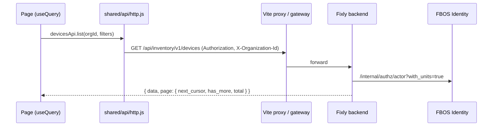

# FBOS console (clientadmin) — the inventory pages

> Branch `ayush-dev4`. Read `SYSTEM.md` (same folder) for the whole system.
> The short reference is also in `CLAUDE.md` → "Inventory (Fixly v2)".

## 1. In one paragraph
`clientadmin/src/features/inventory` shows Fixly's hardware inventory to **FBOS users**. It signs in with the normal FBOS session and calls `/api/inventory/v1`, which is the Fixly backend (Node), not a Python service. It holds data for one organization only, the one that runs the hardware business; any other organization gets `ORGANIZATION_NOT_SERVED`. Customer staff see only their own site. The same features exist in the Fixly web app for Fixly users. Both apps use the same backend rules.

## 2. Files

```
clientadmin/
  vite.config.js                      proxy /api/inventory → INVENTORY_URL (default http://localhost:3000)
  src/shared/api/paths.js             INVENTORY = '/api/inventory/v1'
  src/shared/api/errors.js            FRIENDLY copy for inventory error codes
  src/features/auth/access.js         ACCESS rules for every inventory.* code
  src/features/access/permissions.js  access-editor labels (service "Inventory", entities)
  src/features/documents/api.js       DOCUMENT_SUBJECTS.device = 'inventory.device'
  src/app/App.jsx, pages.js, navigation.jsx   routes, lazy pages, sidebar entries
  src/features/inventory/
    api.js                            devicesApi, inventoryPlacesApi, deviceCatalogApi, purchaseOrdersApi,
                                      transfersApi, installationsApi, issuesApi, replacementsApi, repairsApi,
                                      disposalsApi, inventoryReportsApi
    utils.js                          state / status labels and badge tones, formatDay, money
    flags.js                          inventoryPageOn(key) — one rollout switch per page
    components/                       LifecycleBadge (+Health, Warranty), DeviceTimeline, DeviceActions, ActionForm
    pages/                            Devices, DeviceDetail, StockLocations, Transfers, TransferCreate,
                                      TransferDetail, PurchaseOrders, PurchaseOrderCreate, PurchaseOrderDetail,
                                      DeviceCatalog, Issues, IssueDetail, Repairs, Disposals, InventoryReports
```

## 3. Pages

| Sidebar | Route | Needs | Shows / does |
|---|---|---|---|
| Devices | `/inventory/devices`, `/:id` | `inventory.device.read` | register; device page with timeline, installations, issues, warranty and documents; install, take out, raise issue, send for repair, retire, request disposal |
| Stock | `/inventory/stock` | `inventory.device.read` | stores and stock on hand per model |
| Transfers | `/inventory/transfers`, `/new`, `/:id` | `inventory.stock_transfer.read` | open / in transit / done; new transfer with a stock picker; approve, dispatch, check in, cancel |
| Purchasing | `/inventory/purchase-orders`, `/new`, `/:id`, `/inventory/catalog` | `inventory.purchase_order.read` | orders, submit and approve, goods receipt with QC and serials; models & vendors |
| Device issues | `/inventory/issues`, `/:id` | `inventory.issue.read` | open / mine / overdue / resolved; assign, check in and out, replacement with spare, resolve |
| Repairs | `/inventory/repairs` | `inventory.repair_order.read` | board: approve, send, arrived, close, cancel |
| Disposals | `/inventory/disposals` | `inventory.disposal.read` | approve, record with the wipe certificate |
| Inventory reports | `/inventory/reports` | `inventory.report.read` | by state, stock on hand, warranties ending, out for repair, repeat failures, in transit |

**Rollout switches** (`flags.js`, `VITE_INVENTORY_PAGES`): a comma list of `devices,stock,transfers,purchasing,service,reports`, or `all`. Dev builds show everything; **production builds show nothing until it is set**.

## 4. How data moves

- **Reads** use `useQuery` / `useLookup`, keyed `['devices', orgId, …]`. Writes `invalidate` the lists they change.
- **State changes** send `If-Match: "<version>"`.
- **Goods receipts and dispatches** send an `Idempotency-Key`, one per user action.
- **Errors** arrive as `{ detail: { code, message, meta } }` and show through `friendlyMessage` (`ORGANIZATION_NOT_SERVED`, `DEVICE_NOT_FOUND`, `VERSION_MISMATCH`, `INVALID_LIFECYCLE_TRANSITION`, …).
- **Files** go through `DocumentPanel` with subject `inventory.device`. FBOS Documents asks the Fixly backend whether the user may attach to that device.
- **Dates** come as ISO timestamps. Use `formatDay` (from `features/inventory/utils.js`), not `formatDate`.

## 5. Running
- `~/Projects/fbos/dev-local.sh start` → http://localhost:5174, "Organization" tab, password `FixlyDev@12345`:
  - `ops@fixlydev.example.com`: everything
  - `site-a@fixlydev.example.com`: one site, no prices
  - `tech@fixlydev.example.com`: technician
- Without the script: `npm run dev` in `clientadmin`, with the Fixly backend on :3000 and FBOS Identity on :8001.
- **Verify:** `npm run lint && npm run build`. Both pass.
